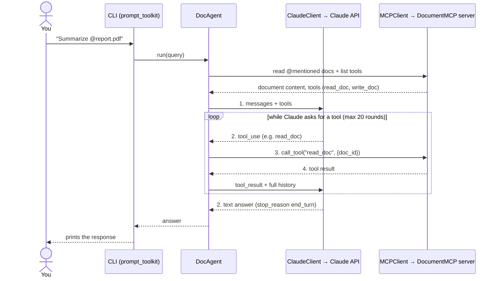
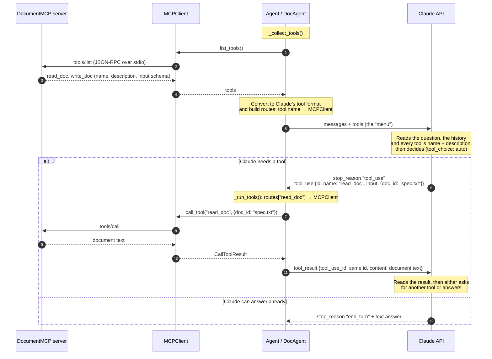

# mcp-claude-poc

A command-line chat app where **Claude** answers questions about a small set of documents served by an **MCP (Model Context Protocol) server**.

```text
┌──────────────────────┐
│         You          │
└──────────────────────┘
      │          ▲
      │ question │ answer
      ▼          │
┌──────────────────────┐
│ CLI (prompt_toolkit) │
└──────────────────────┘
      │          ▲
      │ query    │ answer
      ▼          │
┌──────────────────────┐   1. messages + tools    ┌──────────────┐  HTTPS  ┌────────────┐
│       DocAgent       │ ───────────────────────> │ ClaudeClient │ ──────> │ Claude API │
│   (tool-use loop)    │ <─────────────────────── │              │ <────── │            │
└──────────────────────┘   2. tool_use or text    └──────────────┘         └────────────┘
      │          ▲
      │ 3. call  │ 4. tool
      │    tool  │    result
      ▼          │
┌──────────────────────┐
│      MCPClient       │
└──────────────────────┘
      │          ▲
      │  stdio   │
      │ JSON-RPC │
      ▼          │
┌──────────────────────┐
│  DocumentMCP server  │
│    (subprocess)      │
└──────────────────────┘
```

DocAgent sits in the middle. Claude never talks to the MCP server directly: it only *asks* for a tool call (`tool_use`), DocAgent runs it through `MCPClient`, and sends the result back to Claude. This repeats until Claude replies with text.

One question, step by step:



| Part | File | What it does |
| --- | --- | --- |
| **Server** | `server/mcp_server.py` | MCP server `DocumentMCP`. Tools: `read_doc`, `write_doc`. Resources: `docs://documents`, `docs://documents/{doc_id}`. Prompts: `format`, `summarize` |
| **Client** | `client/mcp_client.py` | Async wrapper around the MCP `ClientSession`; launches a server as a subprocess over stdio |
| **Agent** | `agents/base_agent.py` + `agents/doc_agent.py` | `Agent` runs the tool-use loop; `DocAgent` adds document features on top (see [Agent](#agent)) |
| **Claude client** | `core/claude_client.py` | `ClaudeClient`: async wrapper around the Claude API |
| **Main app** | `main.py` | Starts the server(s), gives Claude their tools, and runs an interactive prompt (or a single `--query`). Claude calls tools in a loop until it has an answer |

## Contents

1. [Quickstart](#quickstart)
2. [Agent](#agent)
   - [`ClaudeClient`](#claudeclient)
   - [Agent loop (`Agent.run`)](#agent-loop-agentrun)
   - [How Claude chooses a tool](#how-claude-chooses-a-tool)
3. [Requirements](#requirements)
   - [Without uv (plain pip)](#without-uv-plain-pip)
4. [Configuration](#configuration)
5. [Usage](#usage)
6. [Run each component](#run-each-component)
   - [1. Chat app (client + Claude + server)](#1-chat-app-client--claude--server)
   - [2. MCP server only](#2-mcp-server-only)
   - [3. MCP client smoke test](#3-mcp-client-smoke-test)
   - [4. MCP Inspector](#4-mcp-inspector)
7. [Run the server alone](#run-the-server-alone)
8. [Testing](#testing)
   - [Client smoke test (no Claude or API key needed)](#client-smoke-test-no-claude-or-api-key-needed)
   - [MCP Inspector (browser UI)](#mcp-inspector-browser-ui)
9. [Troubleshooting](#troubleshooting)
10. [Design notes](#design-notes)
11. [Project layout](#project-layout)

---

## Quickstart

```bash
cd mcp-claude-poc
uv sync                              # creates .venv, installs everything from uv.lock
cp .env.example .env                 # PowerShell: Copy-Item .env.example .env
# edit .env and set ANTHROPIC_API_KEY=sk-ant-...
uv run mcp-claude-poc                # starts the server for you and opens the chat
```

Try: `Summarize @report.pdf` or `/format deposition.md`.

## Agent

The app's agent is **DocAgent**, a **tool-using agent** for documents: Claude decides which MCP tools to call, the agent runs them, feeds the results back, and repeats until Claude has a final answer. It's built from these pieces:

| Piece | Role | Class / file |
| --- | --- | --- |
| Agent loop | Sends requests, runs tool calls, returns results, stops when done. Works with any MCP server | `Agent` – `agents/base_agent.py` |
| Document agent | Adds `@doc` mentions, `/prompt` commands and the document server on top of the loop | `DocAgent(Agent)` – `agents/doc_agent.py` |
| Model | Reasons and chooses tools | `ClaudeClient` – `core/claude_client.py` |
| Tools | Actions and data the agent can use | `MCPClient` sessions – `client/mcp_client.py` → `DocumentMCP` server |

```python
from mcp_claude_poc.agents.doc_agent import DocAgent
from mcp_claude_poc.core.claude_client import ClaudeClient

claude_client = ClaudeClient("claude-opus-5-5", max_tokens=16000, effort="medium")
agent = DocAgent(doc_client=doc_client, clients={"doc_client": doc_client}, claude_client=claude_client)
print(await agent.run("Summarize @report.pdf"))
```

To build another agent, subclass `Agent` and override `_process_query()` (for example `SqlAgent(Agent)`); the loop stays the same.

### `ClaudeClient`

A thin async wrapper around the Anthropic SDK. It makes **one** Messages API call per `send_message()`; it doesn't loop or run tools itself (that's `Agent`'s job).

```python
response = await claude_client.send_message(messages, system="...", tools=tools)
claude_client.add_message(messages, response, "assistant")   # keeps thinking/tool_use blocks
print(claude_client.text_from_message(response))
```

| Member | What it does |
| --- | --- |
| `__init__(model, max_tokens=16000, effort=None)` | Creates an `AsyncAnthropic` client (key from `ANTHROPIC_API_KEY`) |
| `send_message(messages, system=None, stop_sequences=None, tools=None)` | Calls `client.beta.messages.stream` and returns the final message (streaming, so large `max_tokens` values work). Sends optional params only when set; adds `output_config.effort` if `effort` is set; adds the refusal fallback for models in `FALLBACK_MODELS` |
| `add_message(messages, message, role)` | Appends a turn. For a `BetaMessage` it keeps the full `content` list, which the API requires on the next request |
| `text_from_message(message)` | Joins the `text` blocks of a response |

### Agent loop (`Agent.run`)

```text
user query ──> _process_query()            # DocAgent: @mentions inlined, /prompt commands expanded
          ──> _collect_tools()             # tools from every MCP server, name -> server routing
          ┌─> ClaudeClient.send_message(messages, tools)
          │        stop_reason == "tool_use"?
          │          yes: _run_tools() -> MCPClient.call_tool() -> tool_result blocks ─┐
          └──────────────────────────────────────────────────────────────────────────┘
                   no:  return text  ("refusal" / "max_tokens" are reported)
```

- **Max rounds:** `MAX_TOOL_ROUNDS = 20` tool round trips per question, so a runaway loop can't run (and bill) forever.
- **Multiple servers:** tools from every `--server` are offered to Claude. On a name clash, the first server wins.
- **Tool errors** (unknown tool, `MCPError`) go back to Claude as `tool_result` with `is_error: true`, so it can recover instead of crashing. A dead MCP server fails the turn with a `ConnectionError` instead.
- **Memory:** the conversation (`Agent.messages`) lives for the whole chat session, in memory only.

### How Claude chooses a tool

Claude **never runs a tool itself**. Your app sends it a menu of tools with every request; Claude reads the menu, decides whether a tool would help, and if so replies with a structured `tool_use` block saying *which* tool and *with what arguments*. Your code makes the actual call and sends the result back.



#### Step 1: the app sends Claude a menu of tools

Before calling Claude, `Agent._collect_tools()` (`agents/base_agent.py`) asks every MCP server for its tools and converts each one to the Claude API format. The names and descriptions come straight from the `@mcp.tool(...)` decorators in `server/mcp_server.py`:

```json
"tools": [
  {
    "name": "read_doc",
    "description": "Read the contents of a document by its ID.",
    "input_schema": {
      "type": "object",
      "properties": { "doc_id": { "type": "string", "description": "The ID of the document to read." } },
      "required": ["doc_id"]
    }
  },
  {
    "name": "write_doc",
    "description": "Edit a document by replacing old_string with new_string.",
    "input_schema": { "...": "doc_id, old_string, new_string" }
  }
]
```

This list is sent with **every** request: `send_message(self.messages, tools=tools)`.

#### Step 2: Claude decides

Claude reads the question, the conversation so far and each tool's name, description and argument descriptions. By default the API lets Claude decide (`tool_choice: auto`); the code doesn't force a tool.

| Question | What Claude does | Why |
| --- | --- | --- |
| `Summarize @report.pdf` | Answers with text | The document was already inlined by the `@` mention |
| `What's in spec.txt?` | Calls `read_doc` | It needs the content, and `read_doc` "reads the contents of a document" |
| `Fix the typo in plan.md` | Calls `read_doc`, then `write_doc` | It must see the text before it can replace part of it |
| `What is MCP?` | Answers with text | No document is needed |

#### Step 3: Claude's reply names the tool

```json
{
  "stop_reason": "tool_use",
  "content": [
    { "type": "text", "text": "I'll read the spec first." },
    { "type": "tool_use", "id": "toolu_01A...", "name": "read_doc", "input": { "doc_id": "spec.txt" } }
  ]
}
```

| Field | Meaning |
| --- | --- |
| `name` | Which tool to run |
| `input` | The arguments, shaped by that tool's `input_schema` |
| `id` | Links the result back to this exact call |

One reply can contain several `tool_use` blocks.

#### Step 4: the app routes the call and returns the result

`_collect_tools()` also builds `routes`, a map from tool name to the `MCPClient` that owns it. `_run_tools()` looks up `routes[block.name]`, calls `client.call_tool("read_doc", {"doc_id": "spec.txt"})`, and sends the result back with the **same id**. All results for one reply go back together in a single message:

```json
{
  "role": "user",
  "content": [
    { "type": "tool_result", "tool_use_id": "toolu_01A...", "content": "...document text..." }
  ]
}
```

#### Step 5: repeat until Claude answers

Claude reads the result and either asks for another tool (back to step 3) or writes the final text answer (`stop_reason: "end_turn"`). The loop stops after `MAX_TOOL_ROUNDS = 20` rounds at most.

#### Tips for good tool choices

- **Descriptions do the steering.** Claude only knows a tool through its `name`, `description` and argument descriptions. Say what the tool does and when to use it; a vague description leads to wrong or missed calls.
- **The prompt helps too.** `DocAgent` lists the available document IDs and says that a document already included doesn't need a tool. That's why Claude skips `read_doc` for `@`-mentioned documents.
- **Extra servers just work.** Tools from `--server` scripts join the same menu and the same `routes` map, so Claude can use them with no code changes. On a name clash, the first server's tool is used.

## Requirements

| Component | Version | Notes |
| --- | --- | --- |
| Python | 3.14 (`requires-python >=3.14`) | Pinned in `.python-version`; `uv` installs it if missing |
| [uv](https://docs.astral.sh/uv/) | any recent | Package and environment manager |
| `anthropic` (Claude Python SDK) | 2.12.x (`>=2.12,<3`) | Built on `httpx2`; uses the async client |
| `mcp[cli]` (MCP Python SDK) | 2.3.x (`>=2.3,<3`) | Uses `MCPServer` (the 2.x replacement for `FastMCP`) |
| Default model | `claude-opus-5-5` | Thinking is always on; effort defaults to `medium` |
| Node.js | 22+ | Only for the MCP Inspector (`node -v`, `npx -v`) |
| Anthropic API key | – | From <https://platform.claude.com> (Settings → API keys) |

Install uv:

```powershell
# Windows (PowerShell)
powershell -ExecutionPolicy ByPass -c "irm https://astral.sh/uv/install.ps1 | iex"
```

```bash
# macOS / Linux
curl -LsSf https://astral.sh/uv/install.sh | sh
```

### Without uv (plain pip)

```bash
python -m venv .venv
# Windows: .venv\Scripts\activate     macOS/Linux: source .venv/bin/activate
pip install -e .
```

Keep `USE_UV=0` in `.env` and drop the `uv run` prefix from the commands below.

## Configuration

Settings come from `.env`; command-line flags override them.

| `.env` variable | CLI flag | Required | Default | Meaning |
| --- | --- | --- | --- | --- |
| `ANTHROPIC_API_KEY` | `--api-key` | yes | – | Claude API key (`sk-ant-...`). Prefer `.env`: a flag value shows up in shell history and the process list |
| `CLAUDE_MODEL` | `--model` | no | `claude-opus-5-5` | Model ID |
| `MAX_TOKENS` | `--max-tokens` | no | `16000` | Max output tokens per response. Thinking counts toward this, so don't set it low (1024 truncates answers) |
| `CLAUDE_EFFORT` | `--effort` | no | model default | `low` / `medium` / `high` / `xhigh` / `max` |
| `USE_UV` | `--use-uv` / `--no-use-uv` | no | `0` | `1` launches MCP servers with `uv run`; `0` uses the current Python interpreter |
| – | `--server PATH` | no | – | Add another MCP server script (repeatable). Its tools are offered to Claude too |
| – | `-q`, `--query TEXT` | no | – | Ask one question, print the answer, exit |

> `.env` holds your secret key and is listed in `.gitignore`. Never commit it.

## Usage

```bash
uv run mcp-claude-poc                     # interactive chat (starts the server for you)
uv run python -m mcp_claude_poc.main      # equivalent
uv run mcp-claude-poc --help
```

Examples:

```bash
uv run mcp-claude-poc -q "What does @report.pdf say?"
uv run mcp-claude-poc --model claude-sonnet-5-5
uv run mcp-claude-poc --max-tokens 32000 --effort high
uv run mcp-claude-poc --server path/to/other_server.py
```

Inside the chat:

| Input | What happens |
| --- | --- |
| `What is the condenser tower height?` | Claude answers, calling `read_doc` if needed |
| `Summarize @report.pdf` | `@doc_id` inlines that document into the question (press `@` for completion) |
| `/summarize plan.md` | Runs the server's `summarize` prompt (press `/` for completion) |
| `/format deposition.md` | Runs the `format` prompt; Claude rewrites the doc via `write_doc` |
| `Ctrl+C` / `Ctrl+D` | Quit |

Available documents: `deposition.md`, `report.pdf`, `financials.docx`, `outlook.pdf`, `plan.md`, `spec.txt`.
They live in memory, so `write_doc` edits are lost when the app exits.

## Run each component

Run all commands from the project root. Each component can be started in several equivalent ways.

> `uv run main.py` does **not** work: there is no `main.py` in the project root (it's in `src/mcp_claude_poc/`). Use one of the forms below.

| Component | What it starts | Needs API key |
| --- | --- | --- |
| [Chat app](#1-chat-app-client--claude--server) | Chat UI + Claude + DocumentMCP server (auto-started) | yes |
| [MCP server](#2-mcp-server-only) | DocumentMCP server on stdio | no |
| [MCP client smoke test](#3-mcp-client-smoke-test) | Server + client; lists tools, prompts, docs | no |
| [MCP Inspector](#4-mcp-inspector) | Server + browser UI for manual calls | no |

### 1. Chat app (client + Claude + server)

`main.py` starts the server for you, so you don't run the server separately.

```powershell
# a) console script (recommended)
uv run mcp-claude-poc

# b) as a module
uv run python -m mcp_claude_poc.main

# c) by file path
uv run python src/mcp_claude_poc/main.py

# d) inside an activated venv (after `uv sync` or `pip install -e .`)
.venv\Scripts\activate          # macOS/Linux: source .venv/bin/activate
mcp-claude-poc
```

Passing the API key (pick one):

```powershell
# .env file (recommended)
Copy-Item .env.example .env     # then set ANTHROPIC_API_KEY=sk-ant-...

# environment variable, current PowerShell session
$env:ANTHROPIC_API_KEY = "sk-ant-..."
uv run mcp-claude-poc

# command-line flag (visible in shell history and process list)
uv run mcp-claude-poc --api-key sk-ant-...
```

```bash
# environment variable, one command (bash / Git Bash)
ANTHROPIC_API_KEY=sk-ant-... uv run mcp-claude-poc
```

With other options (see [Configuration](#configuration) for all flags):

```powershell
uv run mcp-claude-poc -q "Summarize @report.pdf"            # one question, then exit
uv run mcp-claude-poc --model claude-sonnet-5-5 --effort high
uv run mcp-claude-poc --server path\to\other_server.py      # add another MCP server
uv run python -m mcp_claude_poc.main -- --effort high       # `--` separates app flags from uv's
```

### 2. MCP server only

Speaks MCP over stdio and waits for JSON-RPC on stdin. Use this to plug it into another MCP host (details in [Run the server alone](#run-the-server-alone)).

```powershell
uv run mcp-claude-poc-server                         # console script
uv run python -m mcp_claude_poc.server.mcp_server    # as a module
uv run python src/mcp_claude_poc/server/mcp_server.py
```

### 3. MCP client smoke test

Starts the server through `MCPClient` and prints what it exposes. No Claude call.

```powershell
uv run python -m mcp_claude_poc.client.mcp_client
uv run python src/mcp_claude_poc/client/mcp_client.py
```

### 4. MCP Inspector

Browser UI to call the server's tools, resources and prompts by hand (Node.js 22+). Details in [Testing](#mcp-inspector-browser-ui).

```powershell
npx @modelcontextprotocol/inspector uv run --project . python src/mcp_claude_poc/server/mcp_server.py
uv run mcp dev src/mcp_claude_poc/server/mcp_server.py
```

## Run the server alone

The server speaks MCP over **stdio**, so running it by hand just waits for JSON-RPC on stdin. Use it to wire the server into another MCP host or the Inspector.

```bash
uv run mcp-claude-poc-server
# equivalent:
uv run python src/mcp_claude_poc/server/mcp_server.py
```

Stop it with `Ctrl+C`.

**Claude Desktop** (`claude_desktop_config.json`):

```json
{
  "mcpServers": {
    "documents": {
      "command": "uv",
      "args": ["run", "--project", "C:/path/to/mcp-claude-poc", "mcp-claude-poc-server"]
    }
  }
}
```

**Claude Code:**

```bash
claude mcp add documents -- uv run --project C:/path/to/mcp-claude-poc mcp-claude-poc-server
```

## Testing

### Client smoke test (no Claude or API key needed)

Starts the server, then lists its tools, prompts and documents:

```bash
uv run python -m mcp_claude_poc.client.mcp_client
```

Expected output:

```text
Tools:   ['read_doc', 'write_doc']
Prompts: ['format', 'summarize']
Docs:    ['deposition.md', 'report.pdf', 'financials.docx', 'outlook.pdf', 'plan.md', 'spec.txt']
```

### MCP Inspector (browser UI)

The [MCP Inspector](https://github.com/modelcontextprotocol/inspector) lets you call tools, read resources and render prompts by hand. Requires Node.js 22+.

**Start it** (pick one):

```bash
# Option A: through the MCP CLI bundled with mcp[cli]
uv run mcp dev src/mcp_claude_poc/server/mcp_server.py

# Option B: run the server in this project's .venv (recommended on Windows)
npx @modelcontextprotocol/inspector uv run --project . python src/mcp_claude_poc/server/mcp_server.py
```

The first run asks to install the `@modelcontextprotocol/inspector` npm package. Answer `y`.

**Use it:** the terminal prints a URL like `http://localhost:6274/?MCP_PROXY_AUTH_TOKEN=...` (UI on port 6274, proxy on 6277).

1. Open the **full URL, including the token** (it usually opens automatically).
2. Check **Transport Type = STDIO**. Command and arguments are pre-filled. Click **Connect**.
3. Try the tabs:
   - **Tools** → *List Tools* → `read_doc` → `doc_id = report.pdf` → *Run Tool*
   - **Resources** → *List Resources* → `docs://documents`; *List Templates* → `docs://documents/{doc_id}`
   - **Prompts** → *List Prompts* → `summarize` → `doc_id = plan.md` → *Get Prompt*
4. Stop with `Ctrl+C`.

## Troubleshooting

| Problem | Fix |
| --- | --- |
| `ANTHROPIC_API_KEY is missing` | Put the key in `.env` (the value must not be empty) |
| `Error: ... authentication_error` | The key is invalid |
| `[Response truncated: raise MAX_TOKENS ...]` | Increase `MAX_TOKENS` or `--max-tokens` |
| `[Claude declined this request ...]` | A safety classifier refused, and the fallback model refused too |
| `Script not found` | Wrong `--server` path |
| `uv: command not found` while chatting | Set `USE_UV=0` or install uv |
| `npx not found` | Install Node.js 22+, then open a new terminal |
| Inspector ports 6274/6277 busy | Set `CLIENT_PORT` and `SERVER_PORT` before starting (PowerShell: `$env:CLIENT_PORT=8080`; cmd: `set CLIENT_PORT=8080`) |
| Inspector "Connection error / unauthorized" | Open the full URL with `MCP_PROXY_AUTH_TOKEN`, or paste the token under *Configuration → Proxy Session Token* |
| Inspector Option A fails to start the server | Use Option B, which runs the server in this project's `.venv` |

## Design notes

- **Async client.** Uses `AsyncAnthropic` so API calls don't block the event loop that also runs the MCP sessions.
- **Thinking.** Not configured explicitly. Current models (Opus 5.5, Sonnet 5.5, Fable 5.x) run adaptive thinking by default and **reject** the old `{"type": "enabled", "budget_tokens": N}` form. Control depth with `CLAUDE_EFFORT` / `--effort`.
- **Refusal fallback.** For `claude-opus-5-5` (and the other models listed in `core/claude_client.py`), requests opt into the server-side refusal fallback (`fallbacks: "default"`, beta `server-side-fallback-2026-07-01`). If a safety classifier declines, the API retries on a fallback model within the same call. To turn it off, remove the model from `FALLBACK_MODELS`.
- **Conversation history.** The full assistant `content` (including thinking blocks) is sent back on every turn, as the API requires.

## Project layout

```text
mcp-claude-poc/
├── .env.example            # template for .env
├── pyproject.toml          # deps + console scripts
├── uv.lock
└── src/mcp_claude_poc/
    ├── main.py             # entry point (console script: mcp-claude-poc)
    ├── config.py           # .env + command-line settings
    ├── agents/
    │   ├── base_agent.py     # Agent: tool-use loop (Claude <-> MCP tools)
    │   └── doc_agent.py      # DocAgent(Agent): @mentions and /prompt commands
    ├── client/mcp_client.py
    ├── core/
    │   ├── claude_client.py  # ClaudeClient: Claude API wrapper
    │   └── cli.py            # interactive prompt UI with completion
    └── server/mcp_server.py  # DocumentMCP server (console script: mcp-claude-poc-server)
```
